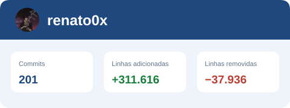
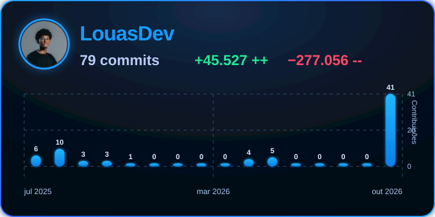
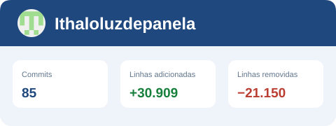



# SUB — Sistema Único Bibliotecário

**Gestão de bibliotecas escolares, do acervo à circulação.**

[O projeto](#sobre-o-projeto) · [Funcionalidades](#funcionalidades) · [Primeiros passos](#primeiros-passos) · [Tecnologias](#tecnologias) · [Documentação](#documentacao) · [Contribuição](#contribuicao) · [Equipe](#equipe-do-projeto) · [Agradecimentos](#agradecimentos)

---

## Sobre o projeto

O **SUB** reúne acervo, usuários, empréstimos e relatórios em uma aplicação para Windows. Desenvolvido para apoiar a rotina das bibliotecas escolares, busca facilitar o atendimento, a organização do acervo e o acompanhamento da circulação de livros na comunidade escolar.

Cada instalação possui sua própria base de dados e identidade institucional. As atividades principais funcionam **sem conexão com a internet**, com armazenamento local. A busca opcional de informações por ISBN e a consulta de atualizações utilizam conexão.

> **Em desenvolvimento:** o código da branch `main` pode conter mudanças ainda em validação. Os pacotes para distribuição são disponibilizados em [Releases](https://github.com/LouasDev/SistemaBiblioteca/releases), quando publicados.

## Funcionalidades

| Área | O que o sistema oferece |
| --- | --- |
| **Acervo** | Cadastro, edição e consulta de livros, controle de quantidades, códigos de barras e busca opcional por ISBN. |
| **Usuários e turmas** | Gestão dos participantes da biblioteca, ativação e desativação de cadastros e mapeamento anual de turmas. |
| **Circulação** | Empréstimos, devoluções, atendimento rápido, prorrogações e acompanhamento de pendências. |
| **Relatórios** | Consultas operacionais, exportação para Excel e geração de documentos e etiquetas em PDF. |
| **Personalização** | Nome, logotipo e tema da instituição, definidos no primeiro uso e nas configurações. |
| **Administração** | Acesso de bibliotecários, recuperação por código mestre, atualizações pelo GitHub e reset com dupla verificação. |

O painel é acessado pelo perfil **Bibliotecário(a)**. Alunos, professores e demais usuários são cadastrados como participantes da circulação.

## Primeiros passos

**Requisitos para uso:** Windows e .NET Framework 4.8.

1. Quando disponível, baixe o pacote `SUB-X.Y.Z.zip` em [Releases](https://github.com/LouasDev/SistemaBiblioteca/releases).
2. Extraia todo o conteúdo para uma pasta com permissão de gravação e execute `SUB.exe`.
3. Siga o assistente para configurar a instituição e criar a primeira conta de bibliotecário.
4. Guarde o **TXT de recuperação** em local seguro: ele é necessário para recuperação de senha e autorização do reset.

Os arquivos **Source code** do GitHub precisam ser compilados. Para executar a partir do código-fonte, consulte o [guia de desenvolvimento](docs/DESENVOLVIMENTO.md).

### Dados e atualizações

Os dados ficam em `%LOCALAPPDATA%\SUB`, associados à conta do Windows. O reset apaga definitivamente essa área, incluindo configurações e backups locais, após as verificações e a confirmação final.

As versões seguem o padrão **`0.0.0`**, como `1.0.2`. O aplicativo recebe atualizações por releases com pacotes assinados; alterações no código-fonte só chegam aos usuários quando uma nova versão é publicada.

## Tecnologias

  

| Aplicação | Tecnologias utilizadas |
| --- | --- |
| **Linguagem e plataforma** | C# · .NET Framework 4.8 |
| **Interface** | Windows Forms · controles personalizados |
| **Banco de dados local** | SQL Server Compact 4.0 · ADO.NET |
| **Planilhas** | ClosedXML |
| **Documentos PDF** | iTextSharp · PDFsharp |
| **Códigos de barras** | ZXing.Net |
| **Configurações e manifestos JSON** | Newtonsoft.Json |

## Documentação

- [Índice completo e situação dos documentos](docs/README.md)
- [Funcionamento atual e regras do sistema](docs/CONTRATO-FUNCIONAL-INSTALACAO-LOCAL.md)
- [Desenvolvimento, compilação e testes](docs/DESENVOLVIMENTO.md)
- [Reset local e exclusão de dados](docs/RESET-LOCAL.md)
- [Versionamento e publicação de atualizações](docs/PUBLICACAO-ATUALIZACOES.md)

## Contribuição

Sugestões e relatos de problemas são bem-vindos nas [issues](https://github.com/LouasDev/SistemaBiblioteca/issues). Para contribuir com código, abra um pull request com a descrição da mudança e das verificações realizadas. Não inclua dados pessoais, bancos reais ou credenciais.

## Equipe do projeto

Alunos responsáveis pelo sistema original e pela construção do SUB, conforme os créditos do painel **Sobre**. As contribuições abaixo registram as principais frentes assumidas pela equipe durante o desenvolvimento.

| Integrante | Contribuições registradas |
| --- | --- |
| [Renato Monteiro](https://github.com/renato0x) | Desenvolvimento front-end e back-end, com atuação nas telas de cadastro de usuários, empréstimos e reservas. |
| [Luis Gustavo](https://github.com/LouasDev) | Desenvolvimento front-end e back-end, incluindo login, devoluções, cadastro de livros e regras de negócio. |
| [Ithalo Pimentel](https://github.com/Ithaloluzdepanela) | Gestão do projeto e documentação, incluindo a organização inicial do repositório e a documentação de uso, instalação e regras de negócio. |

  
  
  

Veja também o [histórico de contribuidores](https://github.com/LouasDev/SistemaBiblioteca/graphs/contributors) do repositório.

## Agradecimentos

Agradecemos à **Escola Estadual Professor Gastão Valle** pelo apoio ao projeto e pelo incentivo à construção de uma solução voltada à comunidade escolar.

Aos professores e tutores **Fernando Junior** e **Antônio Carlos Ramos Filho**, nosso agradecimento pela orientação e pelo apoio ao longo do desenvolvimento.

Agradecemos também à **Secretaria de Estado de Educação de Minas Gerais (SEEMG)** por todo o apoio ao projeto e à iniciativa de seus participantes.

## Licença

O projeto tem como objetivo a distribuição open source. A aplicação menciona MIT, mas o arquivo `LICENSE` ainda precisa ser formalizado pelos responsáveis. As dependências mantêm suas próprias licenças.
